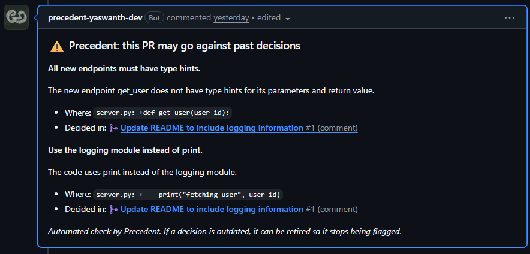
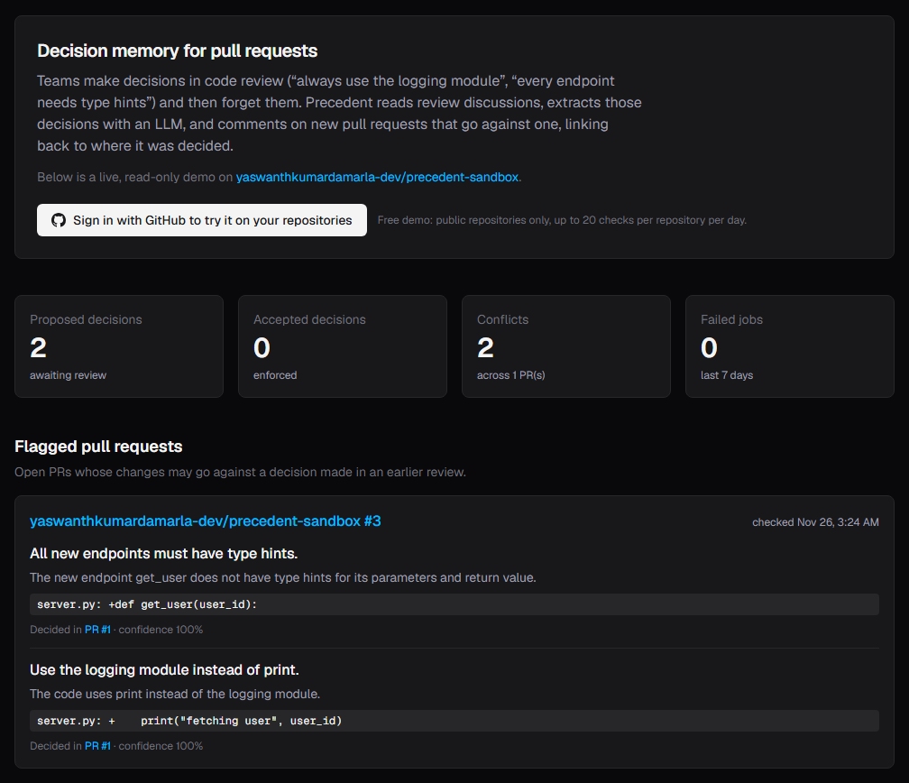
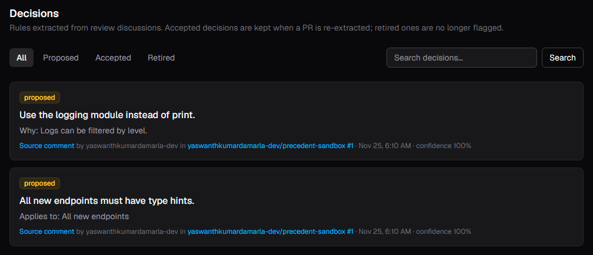
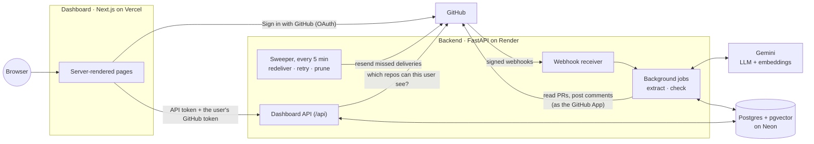

# Precedent

**Decision memory for code review.** Precedent reads pull request review discussions, extracts the engineering decisions a team makes in them, and comments on later pull requests that go against one, linking back to where it was decided.

**Live demo:** https://precedent-ten-kappa.vercel.app. Browse a read-only demo without an account, or **Sign in with GitHub** to try it on your own public repositories. It's free, with daily limits.

[](https://github.com/yaswanthkumardamarla-dev/precedent/actions/workflows/ci.yml)



## Contents

- [The problem](#the-problem)
- [What it does](#what-it-does)
- [Architecture](#architecture)
- [How it works](#how-it-works)
- [Design decisions and trade-offs](#design-decisions-and-trade-offs)
- [Tech stack](#tech-stack)
- [Repository layout](#repository-layout)
- [Running it locally](#running-it-locally)
- [Tests and CI](#tests-and-ci)
- [Deploying for free](#deploying-for-free)
- [Reference: API, data model, configuration](#reference)
- [Limitations and next steps](#limitations-and-next-steps)

## The problem

Teams settle conventions in code review: *"use the logging module, not print"*, *"every new endpoint needs type hints"*. Those agreements stay in merged pull requests that nobody reads again. Reviewers end up writing the same comments over and over, and new contributors never see the decisions at all. Linters only catch the rules someone has taken the time to write down as code.

Precedent turns review discussions into a searchable record of decisions and checks every new pull request against it.

## What it does

Here is a real example from the demo repository, [`precedent-sandbox`](https://github.com/yaswanthkumardamarla-dev/precedent-sandbox):

1. **Remember.** In [PR #1](https://github.com/yaswanthkumardamarla-dev/precedent-sandbox/pull/1), a reviewer asks for the logging module instead of `print`, because logs can be filtered by level, and says new endpoints need type hints. Precedent stores two decisions. Each has a rationale, a scope, a confidence score and a link to the comment it came from.
2. **Check.** [PR #3](https://github.com/yaswanthkumardamarla-dev/precedent-sandbox/pull/3) later adds `def get_user(user_id):` and `print("fetching user", user_id)`. Within a minute Precedent comments on the PR (the screenshot above). The comment names each decision, the offending line, and the review where it was decided. When the author fixes the code, Precedent edits the same comment to say there are no conflicts, instead of posting another one.
3. **Curate.** The dashboard lists every decision. Someone with write access to the repository can **accept** a decision, which keeps it when the PR's discussion is re-read, or **retire** it so it's no longer enforced.

Both proposed and accepted decisions are enforced. Accepting one is how a maintainer confirms it.

| Overview: counts and flagged pull requests | Decisions: filter, search, accept or retire |
| --- | --- |
|  |  |

## Architecture



| Part | What it is | Where it runs |
| --- | --- | --- |
| [`backend/`](backend/) | Python service: receives GitHub webhooks, runs the extraction and check jobs, serves a JSON API to the dashboard | Render (free) |
| [`frontend/`](frontend/) | Next.js dashboard: sign-in, overview, decisions, activity | Vercel (free) |
| Database | Postgres with the pgvector extension, for decisions and their embeddings | Neon (free) |
| GitHub App | [`precedent-yaswanth-dev`](https://github.com/apps/precedent-yaswanth-dev): what people install on their repositories. It sends the webhooks and posts the comments | GitHub |
| Gemini | `gemini-3.5-flash-lite` for extraction and judging, `gemini-embedding-001` for embeddings | Google AI (free tier) |

## How it works

### 1. Receiving webhooks ([`main.py`](backend/app/main.py))

- **Verify.** Every request must carry GitHub's HMAC-SHA256 signature of the body, made with the shared webhook secret. It's compared in constant time, and anything else gets a 401.
- **Decide what to do** (`plan_job`):

  | GitHub event | Job |
  | --- | --- |
  | PR opened, reopened, updated (`synchronize`) or marked ready for review (drafts are skipped) | **check** the PR |
  | PR closed, review comment created or edited, review submitted with a summary, comment on a PR | **extract** decisions from the PR |
  | Anything sent by a bot, including Precedent's own comments | ignored, so Precedent never reacts to itself |

- **Admit or refuse** (`admit`): pull requests in private repositories are skipped, and nothing from their payload is stored. A job is refused once a repository, an account or the whole demo reaches its daily limit (see [free-demo rules](#6-free-demo-rules-and-privacy)).
- **Record, then answer quickly.** Every delivery is stored in `webhook_events`, keyed by GitHub's unique delivery id, so a resend updates the same row. The job then runs as a background task after the response is sent, because GitHub gives up on a webhook after 10 seconds.

### 2. Extracting decisions ([`extract.py`](backend/app/extract.py), [`llm.py`](backend/app/llm.py))

1. Fetch every review comment, PR comment and review summary, leaving out bots.
2. Build a transcript the model can cite. Inline comments are grouped into threads, each with the code under discussion (the diff hunk), followed by the general conversation. Every comment is tagged `[comment <id>]`.
3. Ask Gemini for decisions, using **structured output**: a Pydantic schema with `statement`, `rationale`, `scope`, `source_comment_id` and `confidence`, at temperature 0. The prompt spells out what is *not* a decision: one-off fix requests, questions, "LGTM", and suggestions someone rejected.
4. **Guard against made-up answers.** Drop any decision whose `source_comment_id` isn't a real comment in this PR, and merge duplicates (compared ignoring case and a trailing period).
5. Embed each statement (768 dimensions, task type `RETRIEVAL_DOCUMENT`).
6. Save inside a Postgres **advisory lock** per PR, so two jobs for the same PR take turns. Re-extracting a PR replaces its earlier *proposed* decisions. Decisions someone already accepted or retired are kept as they are, and aren't added back as new proposals.

### 3. Checking a pull request: retrieve, then judge ([`check.py`](backend/app/check.py))

1. Fetch the PR and its changed files: at most 20 files, and at most 4,000 characters of diff per file.
2. **Retrieve.** For each changed file, embed a query made of the PR title, the file name and its *added* lines (task type `RETRIEVAL_QUERY`). Then search the decisions with pgvector's HNSW index by cosine distance: the 5 nearest per file, from the same repository, leaving out retired decisions and decisions made in this same PR. Keep the 10 closest overall.
3. **Judge.** Send Gemini the diff and only those candidate decisions. The prompt favours precision: only added lines count, a related decision is not a conflict, and *"a false alarm is worse than a miss"*.
4. Again, drop any conflict that cites a decision the model wasn't given.
5. Replace the PR's stored conflicts, and **create or update one comment** on the PR. The comment is found again by a hidden HTML marker. A new comment is only posted when there are conflicts, and an existing one is edited to ✅ once they're fixed.

Retrieving first keeps the prompt small and cheap, however many decisions a repository has, and the model only compares the change with rules that are likely to matter.

### 4. Reliability on a free host ([`redeliver.py`](backend/app/redeliver.py), [`jobs.py`](backend/app/jobs.py))

The free Render plan puts the backend to sleep after 15 idle minutes. The webhook that wakes it usually times out, and **GitHub never retries a webhook on its own**. Three mechanisms make up for that:

- **Missed webhooks.** A sweep runs 30 seconds after startup and then every 5 minutes. It lists the App's deliveries from the last 6 hours, finds the failed ones that never reached the database, and asks GitHub to send them again.
- **Failed or interrupted jobs.** The same sweep re-runs jobs that failed, for example because Gemini was briefly unavailable, and jobs stuck as queued or running for 15 minutes, for example because a restart cut them off. Each job gets up to 3 attempts within 6 hours. A job is skipped if a newer run of the same job on the same PR already succeeded. Jobs always work from the PR's *current* state, so they are safe to repeat, and several failures for one PR need only one re-run.
- **Model errors.** Gemini calls time out after 90 seconds and retry on 429 and 5xx responses, waiting 20, 40 and then 60 seconds.

Webhook records are only needed for the Activity page, so they are deleted after 30 days to keep the free database small.

### 5. Sign-in and access control ([`access.py`](backend/app/access.py), [`api.py`](backend/app/api.py), [`frontend/src/app/auth/`](frontend/src/app/auth/), [`session.ts`](frontend/src/lib/session.ts))

- **Sign in with GitHub** uses the GitHub App's OAuth web flow:
  1. `/auth/signin` stores a random `state` in a short-lived cookie and redirects to GitHub.
  2. `/auth/callback` checks that `state`, then exchanges the code for the user's token on the server, using the client secret.
  3. The token, login and avatar are stored in an **httpOnly cookie sealed with AES-GCM**, keyed from `SESSION_SECRET`. The browser can neither read nor forge it.
  4. The session ends 5 minutes before GitHub's 8-hour token does.
  5. The redirect after sign-in only accepts paths on the same site, so the sign-in link can't be used to send people to another site (an "open redirect").
- **The browser never calls the backend.** The Next.js server calls it with a shared `API_TOKEN` (checked in constant time; with no token configured, every request is refused) and passes the signed-in person's GitHub token in an `X-GitHub-Token` header.
- **Permissions come from GitHub.** For each request the backend asks GitHub which repositories that person can reach through Precedent's installations, and at what permission level. The answer is cached for 5 minutes per token, under a hash of the token. Every query is filtered to those repositories. Accepting or retiring a decision also needs admin, maintain or push access to its repository, or the API returns a 403. Without a token, the visitor sees the read-only demo repositories.

### 6. Free-demo rules and privacy

- **Public repositories only.** Pull request code goes to Gemini's free tier, which may use it to improve Google's products. That's fine for public code but not for private code.
- **Daily limits per 24 hours:** 20 checks per repository, 40 per account and 300 across the whole demo, so no one can use up the shared Gemini quota. A refused job is recorded as `limited` and shown on the Activity page.
- **Leaving deletes your data.** Removing Precedent from a repository, or uninstalling it, deletes that repository's decisions, conflicts and webhook records.

## Design decisions and trade-offs

| Decision | Why | Trade-off |
| --- | --- | --- |
| **An LLM extracts the decisions**, rather than keyword rules | Review comments are free-form, and "let's always…" can be phrased a hundred ways | Costs money and can be wrong. Mitigated by structured output, temperature 0, checked citations, a confidence score, and people accepting or retiring decisions |
| **Retrieve, then judge** (embeddings narrow the decisions down, then the LLM decides) | The prompt stays small however many decisions pile up, and the model only sees relevant rules | A relevant decision whose wording is far from the code can be missed. Searching once per changed file reduces this |
| **pgvector inside Postgres**, not a separate vector database | One database for everything, with transactions across decisions and conflicts. Free on Neon | A dedicated vector store would scale further, but HNSW in Postgres is plenty at this size |
| **A GitHub App**, not an OAuth app or a personal token | People install it per repository. It comments as its own bot, gets short-lived installation tokens, and receives webhooks for every installation | More setup: a private key, signed tokens, an installation lookup per repository |
| **Jobs run in the web process**, with a database table as the job log, not a queue like Celery and Redis | Free hosting means a single instance with no extra services. The table plus the sweeper still give retries and visibility | Doesn't scale across several instances. A restart can interrupt a job, and the stuck-job retry picks it up again |
| **Access is checked with GitHub**, rather than kept in Precedent's own user and role tables | Permissions always match GitHub's, and there is nothing to keep in sync | Each new session costs a few GitHub API calls, and changes take up to 5 minutes to show |
| **Precision over recall** when flagging conflicts | A bot that raises false alarms gets muted quickly | Some real conflicts aren't reported |
| **Sessions in a sealed cookie**, not a session store | No extra database or service is needed for sessions | A session can't be revoked from the server before it expires. Revoking the token on GitHub ends it at the next request |
| **Plain SQL with psycopg**, not an ORM | The schema is three tables, and the vector queries read most clearly as SQL | No generated migrations. `schema.sql` is written to be safe to run again on every deploy |

## Tech stack

- **Backend:** Python 3.12, FastAPI, psycopg 3, Pydantic, httpx, PyJWT, `google-genai`
- **Database:** PostgreSQL 17 with pgvector (HNSW index, cosine distance)
- **AI:** Gemini `gemini-3.5-flash-lite` with JSON-schema output; `gemini-embedding-001` at 768 dimensions
- **Frontend:** Next.js 16 (App Router, React Server Components, Server Actions, Partial Prerendering), React 19, TypeScript, Tailwind CSS 4
- **Infrastructure:** Render, Vercel, Neon and GitHub Actions, all on free plans

## Repository layout

```
backend/
  app/
    main.py           webhook receiver: signature check, event → job, limits, cleanup on uninstall
    extract.py        PR discussion → decisions (transcript, citation check, embeddings, save)
    check.py          PR diff → related decisions (vector search) → conflicts → PR comment
    llm.py            every Gemini call: prompts, response schemas, embeddings, retries
    github_client.py  GitHub App auth (signed JWT → installation token), PR data, comment upsert
    jobs.py           run a job, record the result, retry failures, daily limits, data deletion
    redeliver.py      background sweep: resend missed webhooks, retry jobs, prune old records
    access.py         who is asking and which repositories they may see (asks GitHub)
    api.py            JSON API for the dashboard, filtered to the viewer's repositories
    config.py         settings from environment variables
    migrate.py        applies schema.sql
  schema.sql          tables and the vector index (safe to re-run)
  tests/              pytest: webhook routing, signatures, access control, limits, cleanup
frontend/
  src/app/            pages: overview, decisions, activity, login; auth/ for the OAuth routes
  src/components/     header, UI pieces, decision action buttons
  src/lib/api.ts      server-side client for the backend API
  src/lib/session.ts  sealed session cookie
render.yaml           Render Blueprint for the backend
docker-compose.yml    local Postgres with pgvector
.github/workflows/    CI: backend tests against real Postgres; frontend lint and build
```

## Running it locally

**Requirements:** Docker, Python 3.11+, Node.js 20+, a [Gemini API key](https://aistudio.google.com/apikey), and a GitHub App of your own.

**1. Database**

```sh
docker compose up -d          # Postgres 17 with pgvector on port 5432
```

**2. GitHub App.** Create one under **GitHub → Settings → Developer settings → GitHub Apps**:

- **Webhook URL:** a channel from [smee.io](https://smee.io), which forwards webhooks to your machine. When hosted, use `<backend URL>/webhooks/github` instead.
- **Webhook secret:** any random string. It goes in `GITHUB_WEBHOOK_SECRET`.
- **Repository permissions:** Pull requests *Read & write*, Issues *Read & write* (to comment on PRs), Metadata *Read*.
- **Subscribe to events:** Pull request, Pull request review, Pull request review comment, Issue comment. Installation events arrive without subscribing, and Precedent uses them to delete data.
- **Redirect URI** (for Sign in with GitHub): `http://localhost:3000/auth/callback`, plus `<dashboard URL>/auth/callback` when hosted.
- **Setup URL:** `<dashboard URL>/?installed=1`, with **Redirect on update** ticked, so people come back to the dashboard after installing or changing repositories.
- **Where can this GitHub App be installed?** *Any account*, if other people should be able to try it.

Then generate a **private key** and save it as `backend/github-app.pem`, and generate a **client secret** for the dashboard.

**3. Backend**

```sh
cd backend
python -m venv .venv
.venv/Scripts/activate        # Windows; on macOS/Linux: source .venv/bin/activate
pip install -r requirements.txt
cp .env.example .env          # fill in the values; API_TOKEN can be any long random string
python -m app.migrate         # create the tables
uvicorn app.main:app --reload
npx smee-client -u <SMEE_URL> -t http://127.0.0.1:8000/webhooks/github   # in a second terminal
```

`http://127.0.0.1:8000/health` should return `{"status": "ok", "pgvector": "..."}`.

**4. Dashboard.** Create `frontend/.env.local`:

```sh
BACKEND_URL=http://127.0.0.1:8000
BACKEND_API_TOKEN=<the same value as API_TOKEN in backend/.env>
GITHUB_CLIENT_ID=<the GitHub App's Client ID>
GITHUB_CLIENT_SECRET=<the client secret you generated>
SESSION_SECRET=<any random string of 32+ characters>
```

```sh
cd frontend
npm install
npm run dev                   # http://localhost:3000
```

**Running a job by hand.** The webhook runs these automatically, but from `backend/` you can run them on any PR the App is installed on. Add `--show` to print exactly what is sent to the model.

```sh
python -m app.extract OWNER/REPO PR_NUMBER          # extract decisions from a PR's discussion
python -m app.check   OWNER/REPO PR_NUMBER          # check a PR against past decisions
python -m app.check   OWNER/REPO PR_NUMBER --post   # ...and comment on the PR
```

## Tests and CI

```sh
docker compose exec db psql -U precedent -c "CREATE DATABASE precedent_test"   # once
cd backend && pip install -r requirements-dev.txt && python -m pytest -q tests
cd frontend && npm run lint && npm run build
```

There are 28 backend tests. They cover:

- which GitHub events start which job, including that drafts and bots are ignored
- webhook signature checks
- the API token
- that each person sees only their own repositories
- that changing a decision needs write access
- expired GitHub sign-ins
- that private repositories are skipped and their payloads aren't stored
- the daily limits
- that removing or uninstalling the App deletes data
- which missed webhooks are chosen for resending

The database tests use a separate `precedent_test` database, never your real one. They are skipped when that database isn't reachable.

GitHub Actions runs the backend tests against a real pgvector Postgres, then lints and builds the frontend, on every pull request and every push to `main`.

## Deploying for free

| Part | Where | Why there |
| --- | --- | --- |
| Database | [Neon](https://neon.tech) | Free Postgres with pgvector that doesn't expire. Render's free databases are deleted after 30 days |
| Backend | [Render](https://render.com), from [`render.yaml`](render.yaml) | A long-running server, which the background jobs and the sweeper need |
| Dashboard | [Vercel](https://vercel.com) | Built for Next.js, and its free projects don't sleep |

None of them needs a credit card. Set them up in this order:

1. **Neon:** create a project and copy its **pooled** connection string. The tables are created when the backend starts.
2. **Render:** choose **New → Blueprint** and pick this repository. Enter `DATABASE_URL`, `GITHUB_WEBHOOK_SECRET`, `GITHUB_CLIENT_ID` and `GEMINI_API_KEY` when asked. Then add a **Secret File** named `github-app.pem` containing the private key. Once it's deployed, the log shows `[startup] GitHub App key: OK`, and `<URL>/health` returns `"status": "ok"`. Copy the generated `API_TOKEN` from the service's **Environment** page.
3. **Vercel:** import this repository with **Root Directory** set to `frontend`. Add `BACKEND_URL`, `BACKEND_API_TOKEN` (the `API_TOKEN` from Render), `GITHUB_CLIENT_ID`, `GITHUB_CLIENT_SECRET` and `SESSION_SECRET`, then deploy. If you change these variables later, redeploy for the changes to take effect.
4. **GitHub App:** set the **Webhook URL** to `<backend URL>/webhooks/github`, and set the **Redirect URI** and **Setup URL** to the dashboard's addresses (see [step 2 above](#running-it-locally)).

**What "free" costs:** the backend sleeps after 15 idle minutes. So the first page load after a quiet spell can take up to a minute, and a PR comment can arrive a minute or two late, once the sweeper has asked GitHub to resend the missed webhook. Render's always-on plan ($7/month) removes both delays.

## Reference

<details>
<summary><b>API</b></summary>

| Method | Path | What it does |
| --- | --- | --- |
| `POST` | `/webhooks/github` | GitHub webhook receiver (signature-checked) |
| `GET` | `/health` | Database and pgvector check |
| `GET` | `/api/me?refresh=` | The viewer, their repositories, the install link and the limits |
| `GET` | `/api/summary` | Counts for the overview |
| `GET` | `/api/decisions?status=&q=` | Decisions, newest first, each with `can_edit` |
| `PATCH` | `/api/decisions/{id}` | `{"status": "accepted" \| "retired" \| "proposed"}`. Needs write access to the repository |
| `GET` | `/api/conflicts` | Conflicts, each with the decision it cites |
| `GET` | `/api/events?limit=` | Recent webhook deliveries and what was done with each |

Every `/api/*` request needs `Authorization: Bearer <API_TOKEN>`, and is answered for the person in `X-GitHub-Token`, or for the demo repositories when that header is absent.

</details>

<details>
<summary><b>Data model</b> (<a href="backend/schema.sql">schema.sql</a>)</summary>

| Table | Holds |
| --- | --- |
| `decisions` | Repository, PR, statement, rationale, scope, source comment link, author, confidence, status (`proposed`, `accepted` or `retired`), and a `vector(768)` embedding with an HNSW cosine index |
| `conflicts` | A PR that goes against a decision: explanation, evidence, confidence. Deleted along with its decision |
| `webhook_events` | Every delivery: event, repository, the job planned, its status (`queued`, `running`, `done`, `failed`, `ignored`, `skipped` or `limited`), any error, and the number of attempts |

</details>

<details>
<summary><b>Configuration</b></summary>

| Variable | Required | Default and notes |
| --- | --- | --- |
| `DATABASE_URL` | yes | |
| `GITHUB_WEBHOOK_SECRET` | yes | |
| `GITHUB_CLIENT_ID` | yes | The App's Client ID, used to sign its tokens |
| `GITHUB_PRIVATE_KEY_PATH` | | `github-app.pem`, relative to `backend/` |
| `GEMINI_API_KEY` | yes | |
| `GEMINI_MODEL` | | `gemini-3.5-flash-lite` |
| `EMBEDDING_MODEL` | | `gemini-embedding-001`. Keep it the same once decisions are stored |
| `API_TOKEN` | yes | The dashboard sends it as `BACKEND_API_TOKEN` |
| `DEMO_REPOS` | | Comma-separated `OWNER/REPO` list shown to visitors who aren't signed in |
| `REPO_DAILY_JOB_LIMIT`, `OWNER_DAILY_JOB_LIMIT`, `GLOBAL_DAILY_JOB_LIMIT` | | `20`, `40`, `300` |
| `REDELIVERY_SWEEP_SECONDS` | | `300`. `0` turns the sweeper off |
| `BACKEND_URL` (dashboard) | | `http://127.0.0.1:8000` |
| `BACKEND_API_TOKEN` (dashboard) | yes | |
| `GITHUB_CLIENT_ID`, `GITHUB_CLIENT_SECRET` (dashboard) | yes | For Sign in with GitHub |
| `SESSION_SECRET` (dashboard) | yes | 32+ random characters. Changing it signs everyone out |

</details>

## Limitations and next steps

- **No measured accuracy yet.** The next step is a small labelled set of review threads and diffs, so that precision and recall can be measured whenever a prompt or model changes.
- **One instance only.** Jobs run inside the web process. More traffic would need a real queue and separate workers.
- **Decisions belong to one repository.** Organisation-wide decisions, shared across repositories, would be a natural extension.
- **Large PRs are cut down:** at most 20 files, and 4,000 characters of diff per file.
- **Private repositories** would need a paid model tier that doesn't learn from the data it's sent.
